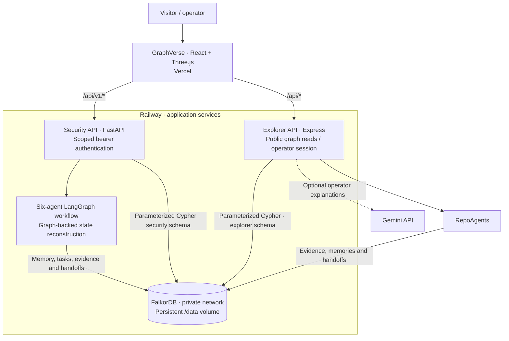

<div align="center">

# SHADOWCHAIN AI

### Follow the evidence. Remember the context.

A graph-powered security investigation platform that connects access relationships,
preserves evidence, and helps agents pick up where an investigation left off.

[](https://www.falkordb.com/)
[](backend/)
[](docs/API_CONTRACT.md)
[](graphverse/)
[](graphverse/)
[](LICENSE)

**Graph exploration · Temporal evidence · Shared agent memory · Persistent handoffs · What-if analysis**

[Open application](https://shadowchain-ai.vercel.app/) ·
[Getting started](#getting-started) ·
[Architecture](#architecture) ·
[API contracts](#api-and-documentation)

</div>

> [!NOTE]
> The hosted explorer is connected to the public
> [ShadowChain AI repository](https://github.com/deveshsinghal09/shadowchain-ai).
> Its inventory, evidence, agent observations, and handoffs are stored in FalkorDB.
> Operators refresh the source from the GitHub panel. Findings are review signals,
> not proof of exploitable access. AWS is disabled and is not required.

## Why we built it

A security finding rarely makes sense on its own. You need to know which identity
changed, what it could reach before, which evidence supports the concern, and what
someone already checked.

ShadowChain brings those connections into one persistent graph. Instead of losing
context between agent runs, the backend records observations, tasks, decisions,
and handoffs alongside the evidence. GraphVerse, the React and Three.js explorer,
makes those relationships easier to inspect.

Built for the **Agent Memory and Coordination** track of WeMakeDevs Graph Hacks 2026. Third-party components retain their own authorship and licenses; eligibility
depends on the organizer's rules and the actual development timeline.

## What you can do

| Capability                    | How it works                                                                                 |
| ----------------------------- | -------------------------------------------------------------------------------------------- |
| Explore connected evidence    | Inspect entities, relationships, and bounded paths in the 3D explorer.                       |
| Reconstruct changes           | Query modeled relationship history using half-open validity intervals in the Python backend. |
| Investigate potential access  | Use deterministic rules and actual Cypher traversals, with evidence attached to findings.    |
| Share investigation context   | Store episodic, semantic, and procedural memories with provenance and version history.       |
| Continue unfinished work      | Reconstruct agent progress, task ownership, and handoffs from FalkorDB after a restart.      |
| Compare possible remediations | Simulate a modeled relationship removal without changing live permissions.                   |

The Python workflows and the explorer have separate graph schemas. The live GitHub pipeline runs six deterministic repository-investigation stages
in the explorer API. The Python IAM/LangGraph workflows remain a separate,
locally tested capability; they are not used to invent AWS findings from GitHub data.

## Architecture



Solid lines show service and storage relationships. Python agent workflows are
implemented and tested locally; their current demo-bound control routes remain
restricted in production. The diagram does not imply a shared schema or a
completed frontend integration for those workflows.

**FalkorDB is the source of truth.** Graph relationships, temporal events,
investigations, evidence, memory versions, tasks, decisions, and handoffs persist
there. Both APIs use official FalkorDB clients and parameterized queries. Core
graph operations fail clearly if the database is unavailable; another database or
an in-memory copy does not take over.

The Railway database has authentication, private networking, AOF persistence,
periodic snapshots, and a persistent volume. Automated backups and restore testing
still need configuration. See the [architecture notes](docs/architecture.md) and
[deployment record](docs/RAILWAY_VERCEL_DEPLOYMENT.md) for details.

## Meet the agents

The backend uses six bounded logical agents. FalkorDB carries their shared context;
LangGraph defines the workflow.

| Agent                  | Role in an investigation                                          |
| ---------------------- | ----------------------------------------------------------------- |
| **Cloud Sentinel**     | Processes configuration events and connects their evidence.       |
| **Identity Guardian**  | Reviews identity, trust, and permission changes.                  |
| **Risk Oracle**        | Traverses the graph and applies deterministic security rules.     |
| **Memory Keeper**      | Retrieves previous work and preserves conflicting observations.   |
| **Coordinator**        | Assigns tasks, tracks dependencies, and records handoffs.         |
| **Response Architect** | Suggests evidence-backed responses and evaluates what-if changes. |

An optional Gemini provider can assist with structured summaries. It cannot invent
graph paths, execute commands, or change cloud permissions. Deterministic operation
is available without a model key or AWS account.

## A look inside


_This screenshot is from the local synthetic walkthrough. It does not show imported
live data or the current contents of the hosted graph._

## Getting started

### Visit the website

Open **[shadowchain-ai.vercel.app](https://shadowchain-ai.vercel.app/)**. Public graph
browsing needs no token. Private investigation history, saving, and configured
Gemini explanations require an operator session.

The GitHub source panel shows the imported commit, the last check time, evidence
coverage, and completed agent tasks. Operators can select **Sync GitHub now** to
refresh the allowlisted public repository. No GitHub token is needed for public
reads within GitHub's anonymous rate limit. AWS, CloudTrail, and Bedrock are not
required; AWS integrations remain disabled.

Operators configure credentials in Railway, never browser code. For token access,
Gemini settings, and service URLs, follow the
[hosting guide](docs/RAILWAY_VERCEL_DEPLOYMENT.md).

### Run the backend locally

You need **Docker Desktop with Linux containers / WSL2**. Host-side development
uses **Python 3.12** and, for GraphVerse, **Node.js 22.12 or later**.

From the repository root in PowerShell:

```powershell
# Create local settings and a private operator credential.
# Existing settings are preserved; generated secrets must stay uncommitted.
powershell -NoProfile -ExecutionPolicy Bypass -File .\scripts\setup.ps1 -SkipPython

docker compose config --quiet
docker compose build backend
docker compose up -d --wait --wait-timeout 120

Invoke-RestMethod http://127.0.0.1:8000/api/v1/health
Invoke-RestMethod http://127.0.0.1:8000/api/v1/ready
```

FalkorDB has no published host port in this Compose stack. Continue with the
[local development guide](docs/LOCAL_DEVELOPMENT.md) for authenticated requests,
Python environments, and isolated graph tests.

The [GraphVerse setup guide](graphverse/README.md) covers the separate local
explorer walkthrough. Its sample-data seed is explicit; do not run it against the
hosted live graph.

## Stack

| Layer              | Tools                                                            |
| ------------------ | ---------------------------------------------------------------- |
| Security API       | Python 3.12, FastAPI, Pydantic v2                                |
| Agent coordination | LangGraph, FalkorDB-backed state reconstruction                  |
| Persistent storage | FalkorDB, official Python and TypeScript clients                 |
| Explorer           | React, TypeScript, Vite, Three.js, React Three Fiber, Drei, GSAP |
| Explorer API       | Node.js, Express, Zod                                            |
| Optional AI        | Gemini with bounded, validated outputs                           |
| Verification       | Pytest, HTTPX, Ruff, Node test runner, Playwright                |
| Hosting            | Vercel, Railway, Docker Compose                                  |

## Verification and current limits

These are **recorded results**, not a live CI status. The linked reports describe
the environments and what each check actually exercised.

| Recorded check                        | Result                                                                                                     | Details                                                |
| ------------------------------------- | ---------------------------------------------------------------------------------------------------------- | ------------------------------------------------------ |
| Python backend audit                  | 457 passed, including 202 real FalkorDB integration tests                                                  | [Completion report](docs/BACKEND_COMPLETION_REPORT.md) |
| Explorer server, public-access update | 30 passed, including real-graph live-pipeline, recovery, simulation, and mocked-provider tests             | [Deployment record](docs/RAILWAY_VERCEL_DEPLOYMENT.md) |
| Local browser suite                   | 6 passed: graph paths, saved evidence, source activity, review, mobile, and reduced motion                 | [Deployment record](docs/RAILWAY_VERCEL_DEPLOYMENT.md) |
| Hosted smoke                          | Health, database readiness, public access, operator login, origin checks, and desktop/mobile checks passed | [Deployment record](docs/RAILWAY_VERCEL_DEPLOYMENT.md) |

A real public GitHub import, graph-backed handoffs, duplicate prevention,
read-only simulation, and reconnect retrieval have been verified. A live Gemini explanation was also validated against graph-derived facts.
Production backup restoration and failover have not been verified. The shared operator session is not a replacement
for individual user accounts. Multiple replicas need shared session configuration.
The hosted Python workflow restrictions must not be bypassed by changing the app
to development mode.

To repeat the checks, use the commands and prerequisites in
[local development](docs/LOCAL_DEVELOPMENT.md) and
[GraphVerse](graphverse/README.md). Integration tests require a real isolated
FalkorDB instance; browser tests use explicitly labeled local fixtures.

## API and documentation

| If you want to…               | Start here                                                                                         |
| ----------------------------- | -------------------------------------------------------------------------------------------------- |
| Understand the data model     | [Graph schema](docs/graph_schema.md)                                                               |
| Connect to the Python backend | [API contract](docs/API_CONTRACT.md)                                                               |
| Connect a public repository   | [GitHub integration](docs/GITHUB_INTEGRATION.md)                                                   |
| Use the explorer endpoints    | [GraphVerse API](graphverse/docs/API.md)                                                           |
| Extend the frontend           | [Frontend integration guide](docs/FRONTEND_INTEGRATION_GUIDE.md)                                   |
| Understand risk and memory    | [Risk engine](docs/risk_engine.md) · [Persistent memory](docs/memory.md)                           |
| Follow an investigation       | [Agents](docs/agents.md) · [Investigations](docs/investigations.md)                                |
| Review safe simulations       | [Remediation](docs/remediation.md)                                                                 |
| Deploy or troubleshoot        | [Railway + Vercel](docs/RAILWAY_VERCEL_DEPLOYMENT.md) · [Troubleshooting](docs/TROUBLESHOOTING.md) |

<details>
<summary><strong>Repository layout</strong></summary>

```text
shadowchain-ai/
├── backend/          FastAPI, repositories, services, agents, and Python tests
├── graphverse/       React/Three.js explorer, Express API, and browser tests
├── deploy/           Private FalkorDB deployment image
├── scripts/          PowerShell setup, checks, and operator utilities
├── docs/             Architecture, contracts, verification, and operating guides
├── docker-compose.yml
├── .env.example
└── LICENSE
```

</details>

## Security boundaries

- Tenant scope and authorization are enforced by the APIs and repositories.
- Credentials stay in server configuration or private operator files, never graph
  properties, prompts, browser bundles, or committed environment files.
- Logs, documents, memories, and model output are untrusted data, not executable
  instructions.
- Simulation and recommendation approval do not execute AWS permission changes.
- Graph connectivity alone does not establish effective AWS authorization.

## The team

Built together by [**Devesh Singhal**](https://github.com/deveshsinghal09),
[**Mayank Gupta**](https://github.com/Mayank2142), and
[**Devesh Raj**](https://github.com/DEVESH859).

See [CONTRIBUTING.md](CONTRIBUTING.md) for contribution guidelines, verification,
and shared-work attribution.

## License

Original project code is released under the **[MIT License](LICENSE)**.
Dependencies, fonts, and container images keep their own licenses and attribution.
See [backend attribution](docs/attribution.md) and
[GraphVerse third-party foundations](graphverse/docs/THIRD_PARTY.md).
