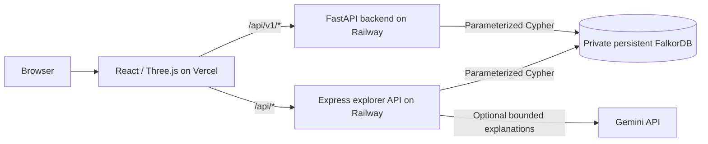
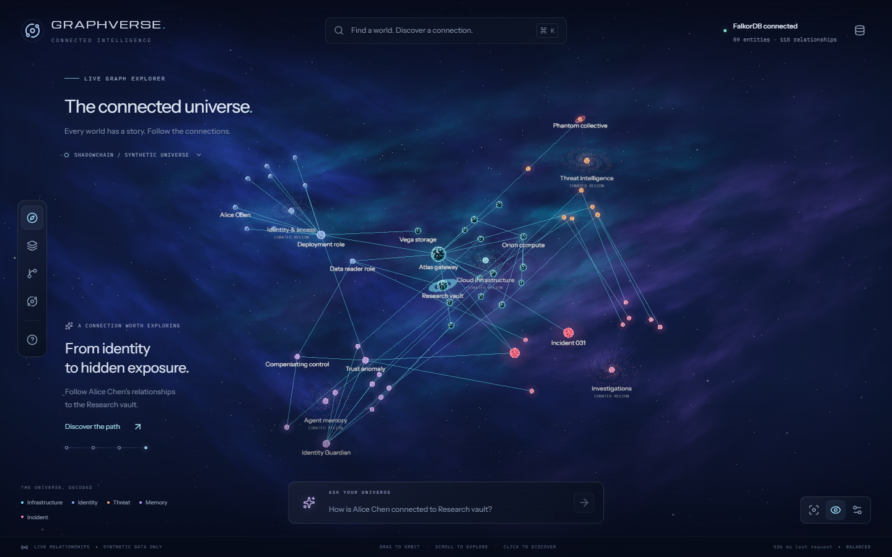

# SHADOWCHAIN AI

**Connected evidence. Persistent memory. Coordinated investigations.**

ShadowChain AI is a graph-powered security investigation platform built around
**FalkorDB**. It models relationships, traces potential security paths, preserves
investigation evidence, and gives logical agents a shared memory that survives
process restarts. GraphVerse provides its React/Three.js graph explorer.

Built for the **Agent Memory and Coordination** track of WeMakeDevs Graph Hacks 2026. Third-party software retains its original authorship and licenses; hackathon
eligibility depends on the organizer's rules and the actual development timeline.

[Open the website](https://shadowchain-ai.vercel.app) ·
[GitHub repository](https://github.com/deveshsinghal09/shadowchain-ai) ·
[Architecture](docs/architecture.md) ·
[API contract](docs/API_CONTRACT.md) ·
[Deployment guide](docs/RAILWAY_VERCEL_DEPLOYMENT.md)

## Current project status

| Component                        | What is available                                                                                                           |
| -------------------------------- | --------------------------------------------------------------------------------------------------------------------------- |
| GraphVerse frontend              | Deployed on Vercel; graph exploration, evidence inspection, path journeys, and saved investigations                         |
| Explorer API                     | Deployed on Railway; authenticated graph reads and bounded Cypher path queries                                              |
| Python API                       | Deployed on Railway; health/readiness and authorized graph/dashboard reads verified                                         |
| FalkorDB                         | Private Railway service with authentication, persistent `/data` storage, AOF, and snapshots                                 |
| Gemini                           | Optional server-side explanations; the hosted key/provider were configured, but a live model response has not been verified |
| Real data source                 | The hosted graph is empty and marked `live-unconfigured`                                                                    |
| GitHub integration               | Planned; no importer or automatic synchronization is connected yet                                                          |
| AWS                              | Optional development integration exists; AWS and CloudTrail are disabled in the hosted deployment                           |
| Six-agent investigation workflow | Implemented and tested with controlled local fixtures; the current demo-bound controls remain restricted in production      |

**The deployed website is not yet a live security monitoring service.** No real
repository inventory has been imported. The Python security model and GraphVerse
currently use separate graph schemas; a live adapter remains to be implemented.

## Why FalkorDB is essential

FalkorDB is the authoritative store for graph relationships, temporal events,
evidence, investigations, memory versions, tasks, decisions, and handoffs in the
supported backend workflows. The official Python and TypeScript clients execute
parameterized Cypher against the actual graph.

- **Relationship traversal:** bounded Cypher queries discover modeled paths and
  return the exact supporting relationships.
- **Historical reconstruction:** half-open validity intervals
  `[valid_from, valid_to)` preserve earlier relationship states.
- **Shared memory:** episodic, semantic, and procedural records link to evidence,
  previous incidents, corrections, and conflicts.
- **Durable coordination:** operation IDs, task ownership, handoffs, and progress
  support reconstruction after a backend restart.
- **Clear dependency failures:** graph operations fail when FalkorDB is unavailable;
  there is no substitute database or authoritative in-memory graph.

The hosted explorer stores its own graph records and saved path snapshots in
FalkorDB. The richer Python memory and coordination model is implemented separately.

## Architecture



The two API services have separate authentication contracts and graph schemas.
The explorer uses a server-validated operator session; Python data endpoints use
scoped bearer credentials. The diagram shows HTTP routing, not a claim that every
Python workflow is exposed through the current frontend.

| Layer                   | Technology                                                       |
| ----------------------- | ---------------------------------------------------------------- |
| Security backend        | Python 3.12, FastAPI, Pydantic v2, pydantic-settings             |
| Coordination            | LangGraph with FalkorDB-backed state reconstruction              |
| Graph database          | FalkorDB and its official clients                                |
| Explorer                | React, TypeScript, Vite, Three.js, React Three Fiber, Drei, GSAP |
| Explorer server         | Node.js, Express, Zod                                            |
| Optional model provider | Gemini; deterministic operation is also available                |
| Testing                 | Pytest, HTTPX, Ruff, Node test runner, Playwright                |
| Deployment              | Railway, Vercel, Docker, Docker Compose                          |

## Investigation capabilities

The Python backend includes temporal event ingestion, deterministic risk analysis,
evidence-backed investigations, persistent agent memory, and non-destructive
remediation simulation. Six bounded logical agents coordinate through the graph:

| Agent              | Responsibility                                                          |
| ------------------ | ----------------------------------------------------------------------- |
| Identity Guardian  | Evaluate modeled identity, trust, and permission changes                |
| Cloud Sentinel     | Process configuration events and connected evidence                     |
| Risk Oracle        | Traverse FalkorDB and evaluate deterministic security rules             |
| Memory Keeper      | Retrieve related history, preserve observations, and identify conflicts |
| Coordinator        | Assign tasks, manage dependencies, and persist handoffs                 |
| Response Architect | Propose evidence-backed responses and read-only what-if analysis        |

These workflows are verified using explicitly synthetic fixtures. They do not
execute AWS permission changes. Findings are **potential attack paths**, not proof
of exploitable access or complete AWS effective authorization.

For the implementation details, see [risk analysis](docs/risk_engine.md),
[memory](docs/memory.md), [agents](docs/agents.md),
[investigations](docs/investigations.md), and [remediation](docs/remediation.md).



_The screenshot shows the local synthetic walkthrough. The hosted graph remains
empty until a real source is connected._

## Use the hosted website

Open **https://shadowchain-ai.vercel.app**. The current deployment uses an operator
token, separate from any GitHub, Gemini, or AWS credential. On the deployment
computer, copy it without printing it:

```powershell
# Run from the project root.
.\scripts\copy-hosted-token.ps1
```

Paste the copied value into the website's connection dialog. Operators on another
computer can retrieve or rotate `GRAPHVERSE_OPERATOR_TOKEN` in Railway's
`graphverse-api` service Variables.

For Gemini, add `GEMINI_API_KEY` to that **Railway service**, set
`GRAPHVERSE_AI_PROVIDER=gemini`, select a model available to your Google project,
and apply/deploy the variable changes. Never place secrets in `VITE_*` variables
or browser code. Amazon Bedrock is not required.

The empty universe is intentional until a real data source is connected. A model
key alone does not import inventory. Read the
[deployment record](docs/RAILWAY_VERCEL_DEPLOYMENT.md) for the exact service setup,
authentication limits, verification results, and remaining work.

## Local setup on Windows

Prerequisites: Docker Desktop with Linux containers/WSL2. Python 3.12 is needed for
host-side backend development; Node.js 22.12 or later is needed for GraphVerse.

From the project root:

```powershell
# Create local settings and a private operator credential.
# Existing settings are preserved. Do not commit the generated .env.
powershell -NoProfile -ExecutionPolicy Bypass -File .\scripts\setup.ps1 -SkipPython

docker compose config --quiet
docker compose build backend
docker compose up -d --wait --wait-timeout 120

Invoke-RestMethod http://127.0.0.1:8000/api/v1/health
Invoke-RestMethod http://127.0.0.1:8000/api/v1/ready
```

FalkorDB has no published host port in the backend Compose stack. Follow the
[local development guide](docs/LOCAL_DEVELOPMENT.md) for scoped API requests,
Python environments, isolated graph tests, and persistence checks.

For the **separate local synthetic GraphVerse walkthrough**, follow
[graphverse/README.md](graphverse/README.md). Its startup script explicitly seeds
sample records; do not point it at the hosted live graph.

## Verification

The repository contains recorded checks, not a live CI badge. Test counts below
refer to the documented verification runs and are not guarantees about every
future checkout or deployment.

| Check                                          | Recorded result                                                                 | Evidence                                               |
| ---------------------------------------------- | ------------------------------------------------------------------------------- | ------------------------------------------------------ |
| Python audit suite                             | 457 passed, including 202 real FalkorDB integration tests                       | [Completion report](docs/BACKEND_COMPLETION_REPORT.md) |
| Explorer server suite after deployment changes | 16 passed, including real graph persistence and isolated Gemini-provider tests  | [Deployment record](docs/RAILWAY_VERCEL_DEPLOYMENT.md) |
| Local explorer browser suite                   | Four passed; paths, save/reload, controls, mobile and reduced motion            | [Deployment record](docs/RAILWAY_VERCEL_DEPLOYMENT.md) |
| Hosted smoke                                   | Health, real graph readiness, login, origin checks, empty graph, desktop/mobile | [Deployment record](docs/RAILWAY_VERCEL_DEPLOYMENT.md) |

Example commands:

```powershell
# Python environment and unit checks.
powershell -NoProfile -ExecutionPolicy Bypass -File .\scripts\setup.ps1
Set-Location .\backend
.\.venv\Scripts\python.exe -m pytest -q
.\.venv\Scripts\python.exe -m ruff check app tests
Set-Location ..

# Integration profile uses a dedicated FalkorDB test service.
docker compose --profile test run --build --rm tests

# Explorer checks; graph integration needs the configured local database.
Set-Location .\graphverse
npm ci
npm run build
npm test
npm run format:check
# Browser tests additionally require the local walkthrough server and Chromium.
npm run test:e2e
```

Live AWS calls, live GitHub imports, a live Gemini response, production backup
restoration, and production failover have not been verified. Read the reports for
the distinction between mocked provider tests and real database behavior.

## Repository map

```text
shadowchain-ai/
  backend/
    app/          FastAPI routes, domain models, repositories, services and agents
    tests/        Unit, API, graph, temporal, memory and recovery tests
    Dockerfile
  graphverse/
    src/          React/Three.js explorer
    server/       Authenticated Express API and FalkorDB queries
    shared/       Typed graph and API responses
    tests/        Playwright browser checks
  deploy/         Private FalkorDB deployment image
  scripts/        PowerShell setup, checks and operator tools
  docs/           Architecture, API contracts, proofs and operating guides
  docker-compose.yml
  .env.example
  LICENSE
```

## Security and operating boundaries

- Credentials stay in server settings or private operator files, never graph
  properties, prompts, frontend bundles, screenshots, or committed environment files.
- Tenant scope and access checks are enforced in repositories and API services.
- Cloud logs, documents, and model outputs are untrusted data. They do not grant
  authority to run commands or modify permissions.
- What-if analysis preserves the original graph permissions; approval records a
  recommendation only.
- The hosted shared operator login is not individual user federation. Broader
  public access, multi-instance sessions, backups, capacity planning, and live
  source authorization need additional work.

Do not publish private credentials in an issue. Review the
[completion report](docs/BACKEND_COMPLETION_REPORT.md),
[troubleshooting guide](docs/TROUBLESHOOTING.md), and
[frontend integration contract](docs/FRONTEND_INTEGRATION_GUIDE.md) before extending
the supported scope.

## Team

Developed collaboratively by:

- [Devesh Singhal · DEVESHSINGHAL09](https://github.com/deveshsinghal09)
- [Mayank Gupta · MAYANK2142](https://github.com/Mayank2142)
- [Devesh Raj · DEVESH859](https://github.com/DEVESH859)

See [CONTRIBUTING.md](CONTRIBUTING.md) for changes, verification, and shared-work
attribution. Commit authorship should describe the actual work performed.

## License and attribution

Original project code is provided under the **[MIT License](LICENSE)**.
Dependencies, fonts, container images, and other third-party components retain
their own licenses. See [backend attribution](docs/attribution.md) and
[GraphVerse third-party foundations](graphverse/docs/THIRD_PARTY.md).
