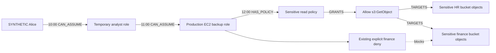

# Temporal synthetic security demo

Dataset **synthetic-2026.1**, introduced with graph schema 3 (current schema 4 adds risk analysis).
All resources, accounts, identities, policies,
security events, investigations and agent observations are synthetic. This implementation
does not import Boto3, call AWS, provision resources, issue credentials or require an LLM key.

The source timeline is fixed to **16 October 2026, UTC**, independent of the wall clock.
`occurred_at` is this synthetic valid-time clock; `ingested_at` records actual UTC ingestion.
They may be different dates. The source clock can be replayed immediately without waiting.

## Inventory

One graph and one reserved demo tenant (`shadowchain-synthetic-demo`) contain a single
shared inventory. The scenarios do not create three copies of the AWS environment.

| Entity | Count | Details |
| --- | --- | --- |
| CloudOrganization | 1 | SYNTHETIC ShadowChain Organization |
| CloudAccount | 2 | Placeholder account numbers `000000000001` and `000000000002` |
| Identity | 12 | Alice, Bob, developers, operators, auditor and synthetic workload users |
| Role | 10 | Includes EC2 web, batch and backup roles with instance-profile/service metadata |
| Policy | 15 | Identity policies and role trust policies; normalized Allow and Deny statements |
| Resource | 20 | 8 S3 buckets, 4 EC2 instances, 3 DynamoDB tables, 2 KMS keys, 2 EBS volumes, 1 log group |
| S3 sensitivity | 4 / 4 | Four sensitive buckets; four non-sensitive buckets |
| Permission | 15 | Action/effect records connected through GRANTS and TARGETS |
| Agent | 2 | Deterministic synthetic scout and verifier records |
| Historical Investigation | 3 | Resolved investigations with retained finding/evidence connections |

There are three baseline role-assumption relationships. Seed creates 88 Entity nodes,
123 typed relationships, the dataset marker and three scenario cursors in one statement.
Every Entity/relationship carries `synthetic=true`, dataset version, tenant and provenance.
Policies store hashes of their actual normalized fixture statements. S3 object permissions
reference bucket object patterns (`/*`) in the fixture representation.

## Scenario A: invisible access path

| UTC | Applied change | Alice's reachable roles | Potential sensitive path |
| --- | --- | --- | --- |
| 09:00 | Secure baseline for Alice | 0 | None |
| 10:00 | Temporary analyst role grant; caller permission and role trust added together | 1 | None |
| 11:00 | Cross-account backup role permission/trust added together | 2 | None |
| 12:00 | Sensitive-read policy attached to backup role | 2 | HR-data path appears |



The same Allow statement targets finance data, but an explicit Deny prevents that potential
path. A CAN_ASSUME edge alone is insufficient: the analysis checks the caller's modeled
`sts:AssumeRole` allowance **and** the destination role's modeled trust policy. This represents
programmatic STS role chaining, not repeated console Switch Role behavior.

The result is a **potential path within a conservative synthetic policy subset**, not a
complete AWS IAM authorization result. This phase models exact resource targets, action
patterns, identity/trust policy grants and explicit denies. It does not evaluate SCP/RCPs,
permissions boundaries, session policies, all condition operators, resource-policy variations,
KMS authorization or S3 object ownership. Unknown condition hashes cannot establish an Allow.

## Scenario B: expired business justification, active access

At 10:00, Bob receives an incident-response role grant for SYNTHETIC INC-204. The source
event records the business justification and expected end at 11:00. The grant references the
Investigation and stores `justification_expires_at` separately from its access interval.

At 11:00 the incident is resolved. A new resolved Investigation version supersedes the open
version, and its half-open validity is recorded. The IAM configuration grant is intentionally
left active. The snapshot flags its expired/resolved justification and the still-active grant.

This is forgotten IAM configuration cleanup. It does not imply that expired STS credentials
remain usable, and no STS credentials are generated. Business justification expiry does not
silently rewrite actual access validity.

## Scenario C: conflicting security memory

At 10:00 the scout retains a suspicious ACL observation, evidence, finding and investigation.
At 11:00 the verifier receives newer policy-context evidence disputing the earlier finding.
Both AgentMemory nodes remain stored and linked to their agents and evidence. CONTRADICTS
edges retain the disagreement. Finding/investigation versions become `disputed` and
`needs_investigation`, with SUPERSEDES links to their earlier versions.

The simulated observations are deterministic event inputs. They are not claims that live
autonomous agents or an AWS scanner have been implemented. No older observation is overwritten
to make the newer observation appear unconditionally authoritative.

## Event and projection contract

`SyntheticSecurityEvent` validates a closed normalized payload: scenario, version, source ID,
placeholder account, sequence, aware source time, event type, optional business justification,
new node/relationship specifications and closure keys. Credentials and server-owned metadata
cannot be supplied as graph properties. Node/relationship kinds and endpoints use the existing
graph validators. New cloud inventory through the event API is prohibited; the inventory is
versioned in the fixture. Events may add investigation/evidence/permission/coordination records.

- Event IDs are UUIDv5 values derived from version, scenario, account and source identifier.
  Identical retries keep the ID; changed content with the same identity returns a conflict.
- Each SecurityEvent stores the validated JSON payload, digest, source time, ingestion time,
  sequence, generation and applied revision in FalkorDB. New observation nodes and all
  projected relationships reference its graph ID for provenance.
- `DemoDataset` stores the manifest digest and shared revision. `DemoStream` stores each
  scenario's sequence, valid-time watermark and reset generation. These are graph records.
- The mutation builder prevalidates against a graph-read snapshot, matches existing endpoints
  before mutations, and builds one parameterized Cypher statement for the event, all related
  changes and cursor advance. A graph revision/generation guard is checked after taking the
  dataset's server-side write lock through a coordination-property update. Concurrent losers
  reread committed graph state; duplicate events reconcile to the existing receipt.
- A late source timestamp returns **409 `late_event_rejected`** with no projection/cursor
  change. A sequence gap returns **409 `event_order_violation`**. Exact duplicates are accepted
  even after later events. Equal source timestamps are ordered by sequence. Streams are
  independently ordered; scenario inspection is scoped to baseline plus that scenario.
- Revocations close edges using `[valid_from, valid_to)`, retain the original edge and record
  the closing event. The event service also supports a validated `close_edges` change; real
  tests revoke Scenario A at 13:00 and prove the path exists at 12:00 but not at 13:00.
- Applied events survive a new connection/service instance. No authoritative cursor, event
  receipt, ownership or projection is stored in a Python dictionary or local JSON file.
  In-process dictionaries are fixture definitions and transient graph-read/query working data.

## Replay, reset and versioning

The bundled replay applies the seven ordered manifest events (A: 3, B: 2, C: 2), optionally
through a source timestamp. Replaying an already-applied prefix returns duplicate receipts;
it does not rewind the stream. Use snapshots to inspect earlier times.

Reset requires the current generation and atomically removes only that scenario's synthetic
records and relationships, resets its cursor and increments its generation. Baseline inventory,
historical investigations, other scenarios and other tenants remain. Cross-scenario dynamic
references are rejected so reset cannot indirectly erase another scenario's relationships.
Old generation requests fail with `demo_generation_conflict`.

Reset restores the versioned fixture's baseline, including discarding custom synthetic
extensions applied through `/events`. Bundled replay replays the manifest; custom events can
be replayed by reposting their saved normalized payloads in contiguous order. Reset is an
explicit demo-only action, not a production evidence-retention operation.

Changing a manifest without changing its declared version is detected: seed/replay/inspection
fail with `demo_dataset_version_conflict`. This release supports `synthetic-2026.1`; future
dataset upgrades need an explicit migration/version change rather than silent reseeding.

## Snapshots and comparisons

Snapshots read the dataset and graph projection from FalkorDB, then filter nodes by source
time and edges by half-open valid-time intervals. They retain historical node versions with
`is_current` flags, preserving evidence connections to older findings. Each snapshot carries
its knowledge revision, inventory counts, potential sensitive paths, reachable roles, stale
business justifications and memory conflicts.

This is valid-time history over currently ingested knowledge, not a bitemporal “what had been
ingested at that wall-clock moment” query. Later valid interval closures can refine historical
interval metadata; source/ingestion timestamps are both retained for audit.

`semantic_sha256` hashes the logical projection and stale-justification state. It excludes
ingestion/update timestamps, generation, physical applied revision and incidental record
fingerprints. Merely querying another time without a semantic change does not change the
digest. Reset/replay reproduces logical IDs, intervals, graph content and semantic digests;
physical ingestion timestamps correctly change. Comparisons return added/removed/changed
node and relationship IDs plus potential paths added/removed.

## API and Windows demonstration

All endpoints are under `/api/v1/demo`. They operate only on the fixed synthetic tenant and
are disabled with 404 when `DEMO_MODE=false` or `APP_ENV=production`. The local Compose API
remains loopback-bound. No tenant identifier or raw Cypher can be submitted through these APIs.

| Method | Path | Purpose |
| --- | --- | --- |
| POST | `/seed` | Atomically seed shared inventory/cursors; preserve existing replay state |
| GET | `/scenarios` | Inspect the versioned event manifest |
| GET | `/scenarios/{A\|B\|C}` | Inspect inventory, persisted cursor, watermark and generation |
| POST | `/scenarios/{scenario}/replay` | Apply manifest prefix; body: generation and optional `through` |
| POST | `/scenarios/{scenario}/reset` | Reset only that scenario; body: current generation |
| POST | `/events` | Ingest a normalized synthetic event plus expected generation |
| GET | `/scenarios/{scenario}/snapshot?at=...` | Inspect a source-time graph snapshot |
| POST | `/scenarios/{scenario}/compare` | Compare `before` and `after` source-time snapshots |

```powershell
# From shadowchain-ai, with the normal persistent backend/FalkorDB running:
powershell -NoProfile -ExecutionPolicy Bypass -File .\scripts\demo-scenario-a.ps1

# Equivalent proof inside the private Docker network (prints JSON):
docker compose exec -T backend python -m app.demo.replay --reset

# Other scenarios:
$base = 'http://127.0.0.1:8000/api/v1/demo'
foreach ($scenario in @('B','C')) {
    $state = Invoke-RestMethod "$base/scenarios/$scenario"
    $body = @{expected_generation=$state.generation} | ConvertTo-Json
    Invoke-RestMethod "$base/scenarios/$scenario/replay" -Method Post `
        -ContentType 'application/json' -Body $body
    Invoke-RestMethod "$base/scenarios/$scenario/snapshot"
}
```

The PowerShell script seeds the environment, resets A using its current generation, and
prints the four timestamp results. It is safe to rerun in this synthetic namespace.
See [Scenario A proof](scenario_a_proof.json) and [Phase 3 verification](phase3_verification.md)
for the actual workstation results.

AWS semantic references used for the normalized model:
[policy evaluation and explicit-deny precedence](https://docs.aws.amazon.com/IAM/latest/UserGuide/reference_policies_evaluation-logic.html),
[caller permission and role trust](https://docs.aws.amazon.com/IAM/latest/UserGuide/id_roles_use_permissions-to-switch.html),
[S3 bucket versus object resource patterns](https://docs.aws.amazon.com/AmazonS3/latest/userguide/access-policy-language-overview.html).
